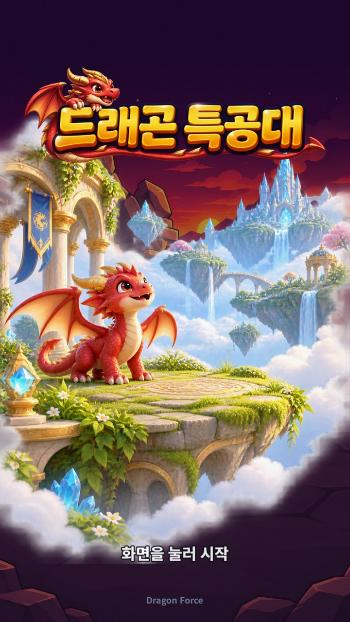
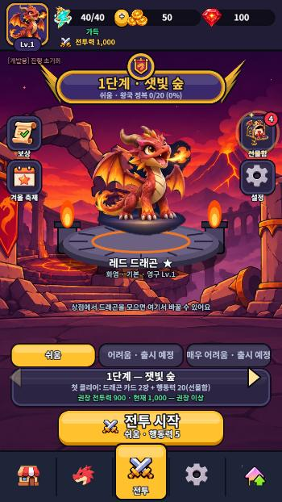
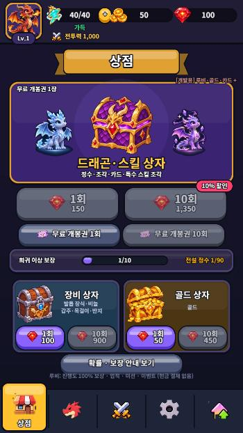
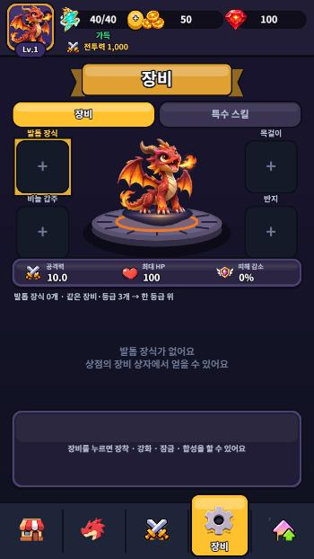
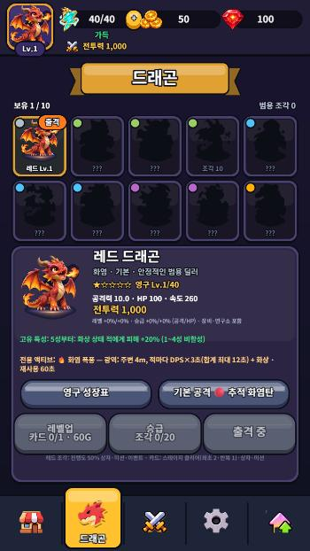
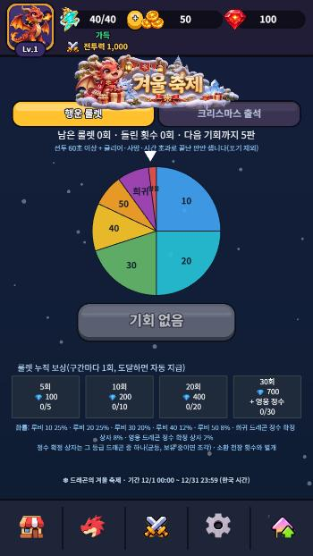
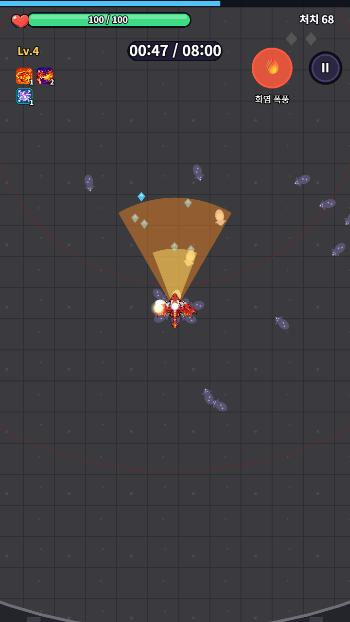
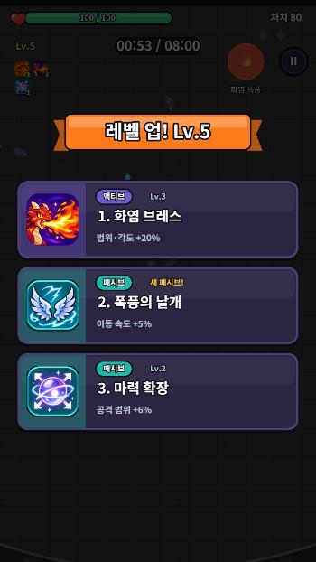
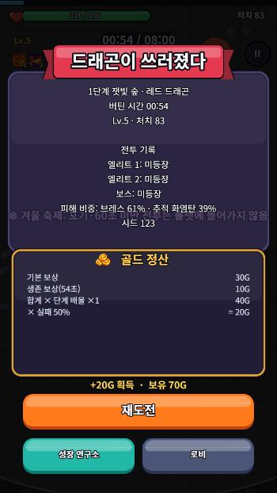

# 기획자 확인용 — 현재 개발 상태 (2026-11-20)

> 이 문서는 기획자(GPT)가 현재 게임을 보고 **추가 요청**을 할 수 있게 정리한 것이다. 기준: GitHub main.
> - 직접 플레이: https://t01054532884-lang.github.io/Dragon-Force/ (main에 올리면 자동 배포, 휴대폰 브라우저 권장)
> - 이 문서: https://github.com/t01054532884-lang/Dragon-Force/blob/main/docs/PLANNER_REVIEW.md
> - 화면 캡처는 개발 서버에서 찍어 위·아래에 작은 "[개발용]" 글씨가 보인다(배포본에는 없음).

## 1. 화면 (8단계 v2.0 반영 후)

| 시작 화면 | 로비 | 상점 |
|---|---|---|
|  |  |  |
| 로고·타이틀 장식, 그림 읽기 진행 막대, 터치하면 로비(이 터치 뒤 배경 음악 시작) | 머리줄(행동력·골드·루비·전투력), 날개 배너, 제단 위 출격 드래곤, 보상·축제·선물함·**설정**, 난이도·단계·권장 전투력, 전투 시작(행동력 5), 하단 탭 | 드래곤·스킬 상자 배너, 1회·10회(10% 할인), 무료 개봉권, 희귀 보장 막대·전설 90회, 장비·골드 상자, 확률 안내 |

| 장비 | 드래곤 | 겨울 축제(12/1~12/31) |
|---|---|---|
|  |  |  |
| 제단 위 드래곤 + 양옆 슬롯 4(발톱 장식·비늘 갑주·목걸이·반지), 능력치 줄, 보유 장비 격자(등급별 그림), 장착·강화·잠금·합성 판, 특수 스킬 탭 | 10종 초상 타일(미보유 실루엣), 상세(능력치·전투력·특성·전용 액티브), 영구 성장표·기본 공격 표는 팝업, 레벨업·승급·출격 | 겨울 배너 그림 제목, 행운 룰렛(전투 5판마다)·누적 보상, 크리스마스 출석 탭 |

| 전투 | 레벨업 3택 | 결과 |
|---|---|---|
|  |  |  |
| 탑다운 레드 드래곤, 하트 HP 막대·시간 알약·보유 스킬 그림 2줄, 전용 액티브 버튼, 일시정지 | 스킬 그림 15장 카드, 종류 배지(기본 주황·액티브 남보라·패시브 청록), 새 스킬·진화 표시 | 리본 제목, 전투 기록, 골드 정산 판, 재도전·연구소·로비 |

연구소·보상(진행도·미션)·선물함도 같은 머리줄·탭·판 모양이다.

## 2. 첫 제출 필수 항목(v2.0 0.5절) 진행

| 항목 | 상태 |
|---|---|
| A·B 로비 | ✅ 시안 형식 |
| C 상점·장비·드래곤 공통 UI | ✅ + 연구소·보상·축제·선물함·전투 화면까지 통일 |
| D 레드 전투 연출 | ✅ 1차: 발사점 섬광·그림만 반동, 화염탄 꼬리, 적중 링·파편, 치명타 ★숫자, Lv.7 폭발(실제 범위까지만), 화상 불씨, 처치 축소·잔광, 보스 처치 충격파, 레벨업 금색 링, 피격은 그림만 붉게 + 큰 피해(HP 15%↑)만 흔들림. 장식은 적 위험 예고 아래에 그림, 개수 상한 |
| E 소리 | ✅ 효과음 26종 + 배경 음악 3곡(로비·전투·보스) 연결, 소리 켜기/끄기 설정 |
| F 기기 검수 | ❌ 아이폰 TestFlight 확인 전 |
| App Store 준비 | 일부: 앱 아이콘 1024(아틀라스 화풍), 개인정보 매니페스트, 지원 페이지 / 남음: 스크린샷, App Store Connect·Codemagic 연결 |

## 3. 소리 배치 요약 (자세히: `docs/SOUND.md`)
- 배경 음악: 시작 화면 터치 뒤 로비 곡(메뉴끼리 이동해도 이어짐) → 전투 시작 전투 곡 → 보스 경고(5:40) 보스 곡 → 결과 화면에서 꺼짐. 0.7초 페이드, 음량 0.35.
- 기본 공격 발사음은 가장 자주 나서 **앞 0.3초만·음량 60%**. 화염탄(레드)·얼음(블루)·번개(옐로)·바람(윈드)·물(워터)·암흑(블랙·아케인). **그린·화이트·스톤 기본 공격은 발사음 없음.**
- 액티브 스킬: 브레스(화염)·얼음 파편·번개 숨결·메테오(폭발음)·날개 폭풍. **드래곤 오브는 발동음 없음**(계속 도는 스킬).
- 회복·금화·보호막 소리: 물약·엘리트 회복·용의 만찬 / 보물 더미 카드 / 수호막 획득·막음.

## 4. 그림 상태 (자세히: `docs/HANDOFF.md` 3절, `docs/ART_REQUEST_4.md`)
- 받아서 쓰는 중: 로비 배경, 상자, 재화, 초상 10, 탑다운 10, 스킬 15, 장비 16, UI 아이콘, 로고, 타이틀 장식, 겨울 배너.
- **아직 이모지로 대신하는 곳(요청서 4)**: 특수 스킬 15 아이콘, 드래곤 전용 액티브 10 아이콘, 연구소 4 아이콘, 범용 조각 1.
- 아직 도형 그림: 적·보스(원본은 받았고 가공 전), 전투 바닥, 날갯짓 프레임.

## 5. 기획자 판단이 필요한 것
1. **배경 음악 길이**: 지금 13~19초 반복. 한 판이 최대 8분이라 반복이 잘 들릴 수 있음 → 45~90초판을 만들지, MP3 반복 이음매가 끊기면 WAV/OGG로 받을지.
2. **발사음이 없는 드래곤**(그린·화이트·스톤)과 드래곤 오브 발동음: 새로 만들지, 지금처럼 조용히 둘지.
3. **시작 화면 배경**: 타이틀 장식 그림 오른쪽 위가 비어 로비 배경이 조금 보임 → 1080×1920 꽉 찬 시작 화면 배경을 새로 그릴지(선택).
4. **난이도 "출시 예정" 표시**: 어려움·매우 어려움 탭에 "출시 예정"이 보임. App Store 심사 2.1(완성도)에서 문제가 될 수 있어 첫 제출에서는 숨길지.
5. 화면 캡처를 보고 바꾸고 싶은 배치·색·문구.

## 6. 요청 보내는 방법
아래 형식으로 제작자에게 주면 개발 AI가 그대로 반영한다(번호별로 따로 판단).
```
[요청 N] 화면/기능:
- 지금: (캡처 번호나 위 표의 설명)
- 바꾸고 싶은 것:
- 이유:
- 우선순위: 첫 제출 필수 / 있으면 좋음 / 출시 후
- 필요한 그림·소리(있으면 파일 이름·크기):
```
